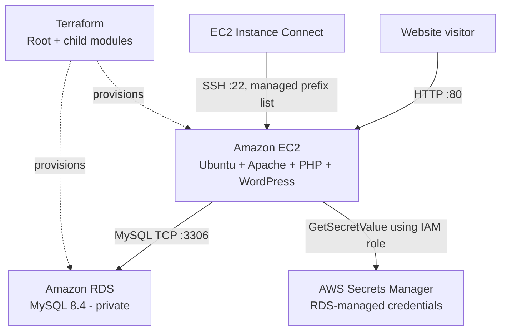

# Deploying WordPress on AWS with Terraform

A hands-on infrastructure-as-code project where I deployed a publicly accessible WordPress website on **AWS**, using **Terraform** to provision the infrastructure and **EC2 user data** to install and configure the application.

The project started as a single Terraform configuration. After getting WordPress working and troubleshooting several deployment failures, I refactored it into **three reusable modules** and introduced input variables, while preserving the existing AWS resources through Terraform `moved` blocks.

## Project overview

The aim was to deploy WordPress on an EC2 instance with a **separate, private Amazon RDS MySQL database**, rather than running the web application and database on the same server.

The deployment uses:

- **Terraform** to define, provision and manage AWS resources.
- **Amazon EC2** to host WordPress on Ubuntu, Apache and PHP.
- **Amazon RDS (MySQL 8.4)** to store WordPress data.
- **AWS Secrets Manager** to manage the RDS master password.
- **IAM** to give EC2 permission to retrieve only the required database secret.
- **Security groups** to control web, SSH and database traffic.
- **Bash user data and WP-CLI** to automate WordPress installation and database configuration.

**Result:** I reached the WordPress installation screen, confirmed the website was accessible, and subsequently refactored the infrastructure into modules without interrupting the working deployment.

## Architecture



The resources were deployed in AWS region **`eu-north-1`**, using the **default VPC** and its existing networking. EC2 received a public address to serve the website, while RDS was configured with `publicly_accessible = false`.

### Network access

| Resource | Traffic | Configuration |
| --- | --- | --- |
| WordPress EC2 | Inbound TCP 80 | HTTP from the internet |
| WordPress EC2 | Inbound TCP 443 | HTTPS port allowed by the security group; TLS was **not** configured in this project |
| WordPress EC2 | Inbound TCP 22 | Restricted to the regional EC2 Instance Connect managed prefix list |
| WordPress EC2 | Outbound TCP 80/443 | Package downloads and updates |
| WordPress EC2 | Outbound TCP 3306 | To the RDS security group |
| RDS MySQL | Inbound TCP 3306 | **Only** from the WordPress EC2 security group |

AWS security groups are stateful, so response traffic for an allowed connection does not require a separate reverse rule.

## Project structure

```text
.
├── main.tf                         # AWS provider, module calls and moved blocks
├── variables.tf                    # Configurable root inputs
├── output.tf                       # EC2 outputs
├── .terraform.lock.hcl             # Locked provider selections
├── modules/
│   ├── ec2/
│   │   ├── main.tf                 # EC2, IAM role, IAM policy and instance profile
│   │   ├── variable.tf             # EC2 module inputs
│   │   ├── output.tf               # EC2 ID and public IP outputs
│   │   └── user_data.tftpl         # WordPress installation and configuration
│   ├── database/
│   │   ├── main.tf                 # RDS MySQL instance
│   │   ├── variables.tf            # Database module inputs
│   │   └── outputs.tf              # Endpoint, database name and secret ARN
│   └── security/
│       ├── main.tf                 # Security groups and their rules
│       └── output.tf               # Security group identifiers
└── README.md
```

### How the modules interact

| Module | Responsibility | Key information passed between modules |
| --- | --- | --- |
| `security` | Creates both security groups and their ingress/egress rules | Outputs the WordPress security group name and RDS security group ID |
| `database` | Creates the private MySQL RDS instance and enables its RDS-managed secret | Receives the RDS security group ID; outputs the database endpoint, name and secret ARN |
| `ec2` | Creates the WordPress server and its IAM resources; runs the user data script | Receives the EC2 security group name and the database endpoint, name and secret ARN |

The **root module** connects these modules by passing child-module outputs into other child modules as input variables. The security module does not require inputs for its existing configuration because it creates and references both of its security groups internally.

## Automated WordPress installation

I initially explored a preconfigured WordPress Marketplace AMI, but eventually moved to a **Canonical Ubuntu Server 26.04 LTS x86_64 AMI** and installed the web stack myself using an EC2 user data script.

The `modules/ec2/user_data.tftpl` script:

1. Updates package lists and installs Apache, PHP, the required PHP extensions, `curl`, `jq` and the AWS CLI.
2. Downloads the official WordPress archive and extracts it into `/var/www/html`.
3. Removes Apache's default `index.html` page so WordPress can be served instead.
4. Installs WP-CLI.
5. Retrieves the RDS master credentials from Secrets Manager using the EC2 instance role.
6. Extracts the database username and password from the returned JSON using `jq`.
7. Creates `wp-config.php` with the RDS database name, endpoint and credentials, passing the password to WP-CLI through standard input instead of a normal command-line argument.
8. Sets appropriate file ownership and permissions: WordPress content is writable by `www-data`, while `wp-config.php` is restricted to `root:www-data` with mode `640`.

Terraform supplies the **secret ARN, RDS endpoint and database name** to the script through `templatefile()`. The database password itself is retrieved by EC2 at boot time; it is not hardcoded in the Terraform configuration.

The initial **WordPress site/admin setup** is completed through WordPress's browser-based installation screen.

## IAM and secrets management

I configured an IAM role for EC2 with a trust policy that allows the EC2 service to assume it. An IAM policy grants `secretsmanager:GetSecretValue` access to the **specific RDS-managed secret ARN**, rather than unrestricted access to Secrets Manager.

An IAM instance profile attaches this role to EC2, avoiding the need to store AWS access keys on the server. The EC2 resource also has an explicit `depends_on` relationship with the IAM policy attachment so Terraform creates the attachment before launching the instance.

RDS manages its master password with `manage_master_user_password = true`. This keeps the password out of hardcoded infrastructure configuration, although the running WordPress application still needs its database credentials in its protected configuration file.

## Configurable inputs

After the deployment and module refactor worked, I replaced several hardcoded values with Terraform input variables:

| Root variable | Purpose | Value used during this project |
| --- | --- | --- |
| `ec2_instance_type` | EC2 instance size | `t3.micro` |
| `ami_id` | Ubuntu EC2 AMI | Ubuntu Server 26.04 LTS x86_64 AMI for `eu-north-1` |
| `rds_instance_class` | RDS instance class | `db.t3.micro` |

The AMI ID is **region-specific** and should be checked before deploying in another region. Other settings, including RDS storage, may still be defined directly in the module code.

I introduced these variables with their existing values and verified that Terraform planned **no infrastructure changes**.

## How to deploy

### Prerequisites

- Terraform compatible with the project's `required_version` constraint (`>= 1.5.0`); the AWS provider is constrained to the `5.x` release series.
- AWS credentials configured locally with permission to create the required EC2, RDS, IAM, security group and Secrets Manager resources.
- An AWS account with a usable default VPC in `eu-north-1` (or equivalent configuration adjustments for another region/VPC).
- An available, compatible Ubuntu AMI ID set through the project's `ami_id` input.

### Deployment workflow

Clone the repository, open a terminal in its root directory, and review the variable defaults before provisioning anything.

```bash
terraform init
terraform fmt -recursive
terraform validate
terraform plan
terraform apply
```

Only approve `terraform apply` after inspecting the proposed resources and costs.

Once AWS has provisioned the infrastructure, use:

```bash
terraform output
```

Open the EC2 public IP in your browser over HTTP. The user data setup may still be running even after Terraform finishes applying, so check cloud-init if WordPress is not yet available. When the WordPress installation screen appears, complete its initial site setup in the browser.

> **Security:** This is a learning deployment, not production-ready hosting. The security group allows port 443, but an HTTPS certificate and TLS configuration were not implemented. Do not use HTTP for sensitive production traffic. Do not commit Terraform state, passwords, private keys or secret-bearing files to Git.

## Troubleshooting and what I learned

The most useful part of this assignment was diagnosing actual deployment problems instead of repeatedly rebuilding resources without understanding why they failed.

### 1. Marketplace AMI and MySQL memory failure

My first approach used a WordPress Marketplace AMI. After dealing with Marketplace subscription/launch issues, the EC2 instance became reachable, but the browser showed the **Apache default page** rather than WordPress.

I connected using **EC2 Instance Connect** and inspected cloud-init logs. The logs showed that MySQL package configuration had failed. The more specific error was **exit status 137**, which suggested the process had been killed.

I checked the kernel logs:

```bash
sudo grep -niE 'mysql|error|failed' /var/log/cloud-init-output.log | tail -n 40
sudo dmesg -T | grep -iE 'out of memory|oom|killed process'
```

The kernel confirmed the **out-of-memory (OOM) killer** had terminated the local MySQL process. The original `t3.micro` only had 1 GiB of memory, and the Marketplace image was trying to configure a local database even though I had already provisioned a separate RDS database.

I tried a larger EC2 instance, but the image still did not produce the expected WordPress installation. I changed direction: **use a clean Ubuntu image and install only the software required on EC2**, leaving MySQL server duties to RDS.

### 2. Apache default page caused by a user data error

On the clean Ubuntu deployment, I saw the Apache welcome page again. This time I checked whether cloud-init had completed:

```bash
sudo cloud-init status --long
sudo tail -n 80 /var/log/cloud-init-output.log
sudo ls -la /var/www/html
```

Cloud-init reported an error, and `/var/www/html` contained only `index.html`. The logs included:

```text
E: Unable to locate package cli
```

This turned out to be a package-name typo in the PHP installation command: `cli` had been treated as a separate package instead of using `php-cli`.

To examine the exact user data that EC2 executed, I used:

```bash
sudo grep -n 'apt-get install' /var/lib/cloud/instance/scripts/part-001
sudo sed -n '13,20p' /var/lib/cloud/instance/scripts/part-001
```

After fixing the package name, I used Terraform's **`-replace`** option to recreate only the EC2 instance, keeping RDS and the other resources in place. WordPress then reached its installation screen successfully.

### 3. Refactoring live infrastructure into modules

Once WordPress worked, I moved the existing RDS, EC2/IAM and security group resources into child modules. Simply moving a resource block changes its **Terraform address**, which can otherwise cause Terraform to propose destroying and recreating working resources.

I used `moved` blocks to map existing addresses to their new module addresses. For example:

```hcl
moved {
  from = aws_db_instance.wordpress_db
  to   = module.database.aws_db_instance.wordpress_db
}
```

While moving the security group rules, a plan initially proposed deleting one rule and creating another. I investigated and corrected a mistake in the resource move configuration rather than approving the change.

After the corrections, the plans showed **`0 to add, 0 to change, 0 to destroy`** for the refactor. I applied the state migration, checked the new addresses with `terraform state list`, and confirmed the website still worked.

This reinforced why **reviewing `terraform plan` before `terraform apply`** is essential, particularly when changing infrastructure that already exists.

## Verification

I verified the project through the following checks:

- `terraform validate` passed for the final configuration.
- `terraform plan` showed no unintended changes after modularisation and variable refactoring.
- `terraform state list` showed the resources being tracked under their new module addresses.
- The WordPress installation page loaded through the public EC2 endpoint, and the website remained accessible after refactoring.
- RDS was configured with `publicly_accessible = false`, and its inbound MySQL rule referenced the WordPress security group.


## Current scope and possible improvements

This was built as a **learning project**, so I deliberately kept the architecture manageable. It uses a single public EC2 instance, the default VPC and a local Terraform state file. It does **not** yet include an HTTPS termination setup, a load balancer, autoscaling, or production-grade monitoring and backup arrangements.

Useful follow-up improvements would be to configure HTTPS, move Terraform state to a secured remote backend with locking, introduce more explicit networking, and add monitoring and backup/recovery controls.

## Tear down and costs

This project creates billable AWS resources, including EC2, RDS and associated services. When the testing and evidence collection are complete, preview the teardown and then destroy the resources:

```bash
terraform plan -destroy
terraform destroy
terraform state list
```

The last command should show no remaining managed resources after a successful destroy. Check the AWS console separately for any resources that may remain outside Terraform's state.

**Important:** The RDS resource uses `skip_final_snapshot = true`, so deleting it does **not** preserve a final database snapshot. Export or back up any data you want to keep **before** destruction.

## Key takeaways

This assignment gave me hands-on experience with Terraform's workflow (`init`, `fmt`, `validate`, `plan`, `apply`, `state` and `destroy`), AWS networking and IAM, Bash automation, RDS/Secrets Manager integration, troubleshooting with Linux logs, and safely refactoring existing infrastructure using modules, inputs, outputs and `moved` blocks.

The biggest lesson was to **investigate the evidence before changing the infrastructure**. Reading cloud-init logs and Terraform plans helped me find the specific problems, fix them and keep the rest of the deployment intact.
